<p align="center">
  
</p>

<p align="center">
  <a href="https://www.tumblrr.tech/"></a>
  <a href="https://anshumaansinghh.github.io/billbrake/"></a>
  <a href="https://www.linkedin.com/in/anshumaan-singh-52090a259/"></a>
  
</p>

## Hi, I'm Anshumaan 👋

I build tools for problems teams only notice when it is too late: the AI agent that fails in front of a customer, the surprise cloud bill, the README example that stopped working.

I care about the boring details. Every claim gets a source, every tool gets tests before launch, and I would rather ship one small thing that works than a big thing that almost does.

```ts
const anshumaan = {
  role: "Software engineer · founder-minded builder",
  building: ["Tumblrr AI", "BillBrake", "PasteProof"],
  focus: ["AI agent reliability", "developer tools", "SaaS"],
  stack: ["TypeScript", "JavaScript", "Node.js", "Python", "C++", "Java", "SQL"],
  principles: ["ship small, ship often", "every claim has a source", "tests before launch"],
  openTo: ["co-founding", "early-stage teams", "open-source collaboration"],
};
```

## 🚀 Building now

| Project | What it does |
|---|---|
| **[Tumblrr AI](https://www.tumblrr.tech/)** | Breaks production AI agents on purpose, before your customers do. Domain-specific adversarial cases, consistency runs and severity-ranked findings reports. |
| **[BillBrake](https://github.com/AnshumaanSinghh/billbrake)** · [live site](https://anshumaansinghh.github.io/billbrake/) | A free, open-source guide to which of 32 developer services (AWS, Google Cloud, Vercel, OpenAI, Firebase and more) can surprise you with a bill, and how to put a hard spending cap on each. Every claim links to official documentation, and a monthly check flags anything that needs re-verifying. |
| **PasteProof** · coming soon | Finds every code example in a README, runs it in seven languages, and points to the exact line that broke. One command, zero dependencies. |

## 🛠 Featured projects

| Project | Highlights |
|---|---|
| **[YouNxt AI](https://github.com/AnshumaanSinghh/younxt)** | An AI-powered decision engine that simulates future outcomes to help people make better choices. Multi-model AI orchestration with a fail-safe architecture. |
| **[TaskFlow](https://github.com/AnshumaanSinghh/team-task-manager)** | A team task-management SaaS: Kanban boards, analytics, role-based access control and dark mode. |
| **[Unbeatable Tic Tac Toe](https://github.com/AnshumaanSinghh/Tictactoe)** | Minimax with alpha-beta pruning, so Hard mode is mathematically unbeatable. Clean architecture and a polished desktop-style UI. |

## 🧠 How I work

- **Read the source, not the summary.** Official docs and real behaviour beat blog posts.
- **Small, sharp tools.** PasteProof has zero runtime dependencies, on purpose.
- **Prove it before shipping.** Tests, real-world checks and a link check before anything goes public.
- **Write for beginners.** If a sentence needs a second read, I rewrite it.

## 🧰 Tech I use

<p>
  
  
  
  
  
  
  
  
  
  
  
</p>

## 📡 Right now

- 🔭 Building Tumblrr AI, and BillBrake and PasteProof in public
- 💬 Ask me about testing AI agents, cloud billing traps, developer tools, Node.js or Python
- 🤝 Looking for co-founders, collaborators and early users for developer tools
- 🌐 Website: [tumblrr.tech](https://www.tumblrr.tech/)
- 📫 The fastest way to reach me is [LinkedIn](https://www.linkedin.com/in/anshumaan-singh-52090a259/)

---

<p align="center"><sub>If something I built saved you time or money, a ⭐ on the repo helps other people find it.</sub></p>
